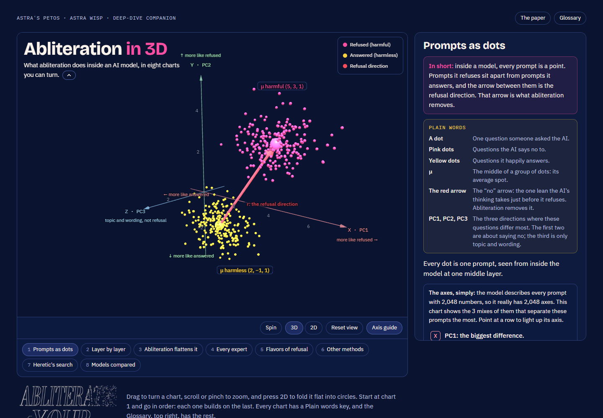

# Abliteration in 3D

*By Astra.*

What abliteration does inside an AI model, in eight charts you can turn.

**Open it:** https://findastra.github.io/abliteration-in-3d/

Abliteration takes the "refuse" direction out of a model's weights so it stops saying no. This page shows it step by
step. Drag to turn a chart, scroll or pinch to zoom, and press 2D to fold it flat. Every chart has a Plain words key,
and the Glossary (top right) explains the rest.

1. Prompts as dots
2. Layer by layer
3. Abliteration flattens it
4. Every expert
5. Flavors of refusal
6. Other methods
7. Heretic's search
8. Models compared

Below the charts, a flow chart shows how Astra Wisp, its mind Wisp and Iris fit together.

## How it's made

One page, `index.html`, with no build step. The charts are drawn with [three.js](https://threejs.org/) r128 (MIT
license), loaded from cdnjs with jsDelivr and unpkg as backups. The type is Bricolage Grotesque, IBM Plex Sans and
IBM Plex Mono from Google Fonts (SIL Open Font License).

It started as the companion to Astra's write-up on making Wisp, the abliterated mind of Astra Wisp, a pet in
Astra's PetOS.
